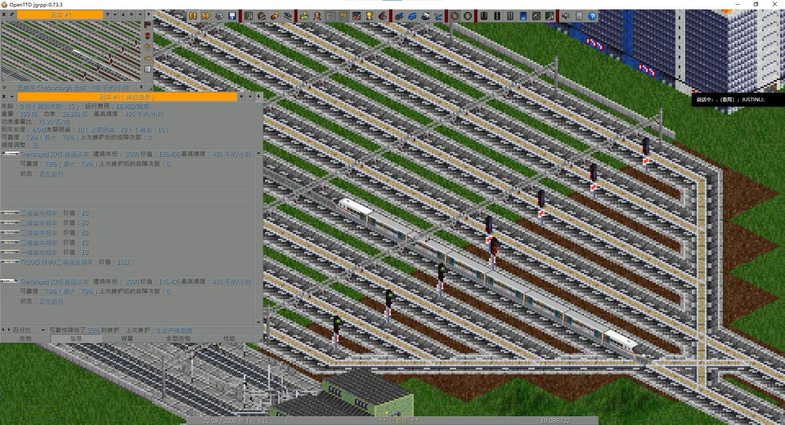

# China Fictional Maglev Set

[中文说明](README_zh.md)

**0.1.1-alpha**

Source: <https://github.com/Alexei124r/OpenTTD-China-Fictional-Maglev-Set>

China Fictional Maglev Set is an unofficial, fictional maglev vehicle set for
OpenTTD. It currently includes TR08, TR2012, TR2015 passenger stock, TR2015F
freight stock, and the MR2015 maglev engineering vehicle.



## Current contents

- TR08 passenger head cars in three liveries.
- TR2012 passenger head cars in nine liveries.
- TR2015 passenger head car with Red Dragon, Silver Sword and Shanghai Metro
  Link liveries.
- TR2015 first-class, second-class and baggage/second-class intermediate cars.
- TR2015F freight head, general freight, refrigerated and baggage/second-class
  stock.
- MR2015 engineering/towing vehicle with consist-dependent speed and power
  isolation.
- Configurable passenger capacity, purchase cost, running cost, mail capacity,
  loading speed and cargo ageing.

This demo is not feature complete. A dining car, additional train models and
other content are planned for later updates.

## Vehicle mechanics

Each logical vehicle is built from a 2 + 8 + 2 articulated layout. Only the
central part displays a sprite. Intermediate-car statistics and liveries are
provided through the leading head car's `livery_override`.

MR2015 runs at 160 km/h alone or with other engineering vehicles. When it is
mixed with passenger or freight rolling stock, the consist is limited to
100 km/h and power from non-MR2015 vehicles is disabled.

## Installation

After the first public release, the GRF will be available through OpenTTD's
online content service. Until then, place `china_fictional_maglev.grf` in your
OpenTTD `newgrf` directory and enable it in NewGRF Settings.

## Building

Build requirements and exact commands are documented in
[BUILDING.md](BUILDING.md).

Quick build using the existing processed game sprites:

```powershell
nmlc -c -l lang --default-lang=english.lng `
  -o china_fictional_maglev.grf china_fictional_maglev.nml
```

## Credits

Project contributors:

- Zhengyu Huo
- Alexei124r
- justinli489
- Xianyu
- Misaka13113
- Luoyezhiqiu

All contributors produced voxel models and participated in design discussions.
Additional responsibilities:

- Alexei124r and justinli489: NML code.
- Alexei124r: final image and sprite production.
- Alexei124r and Zhengyu Huo: initial worldbuilding, with all members contributing to the
  setting.
- justinli489 and Xianyu: voxel-model standards.
- Misaka13113 and Luoyezhiqiu: detailed design planning.
- Alexei124r and Xianyu: testing and balancing.
- Alexei124r and justinli489: documentation.
- Work planning: collective discussion.

AI assistance:

Parts of the code, documentation, voxel assets and image preparation were
developed with AI assistance under human direction and review. AI systems are
not listed as copyright holders or project authors.

## Design references

The project acknowledges the following sets as design and implementation
references. Their source or artwork is not bundled with this project.

- [China Set: Trains](https://github.com/OpenTTD-China-Set/China-Set-Trains)
- [xUSSR Railway Set](https://github.com/George-VB/xussrset)

## Disclaimer

This is an unofficial fan-made set. It is not affiliated with or endorsed by
Shanghai Metro, Transrapid, ThyssenKrupp, or any railway operator.

## License

Copyright (C) 2026 Andy, Bob, Carl, Dennis, Eric, Frank

SPDX-License-Identifier: GPL-2.0-only

This program is free software; you can redistribute it and/or modify it under
the terms of the GNU General Public License as published by the Free Software
Foundation, version 2 only.

This program is distributed in the hope that it will be useful, but WITHOUT
ANY WARRANTY; without even the implied warranty of MERCHANTABILITY or FITNESS
FOR A PARTICULAR PURPOSE. See the GNU General Public License for more details.

You should have received a copy of the GNU General Public License along with
this program. If not, see
<https://www.gnu.org/licenses/old-licenses/gpl-2.0.html>.
