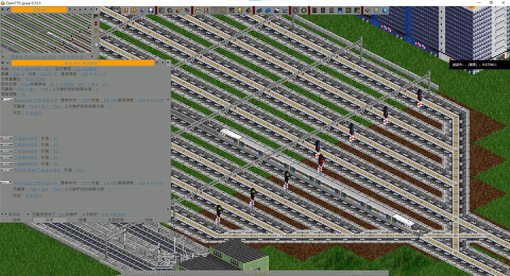

# 中国架空磁浮车辆包

[English](README.md)

**0.1.2-alpha**

源码地址：<https://github.com/Alexei124r/OpenTTD-China-Fictional-Maglev-Set>

China Fictional Maglev Set 是一个面向 OpenTTD 的非官方架空磁浮车辆包。
目前包含 TR08、TR2012、TR2015 客运车辆、TR2015F 货运车辆，以及
MR2015 磁浮轨道工程车。



## 当前内容

- TR08 客运头车，3 种涂装。
- TR2012 客运头车，9 种涂装。
- TR2015 客运头车，包含红神龙、银长剑和上海地铁联动涂装。
- TR2015 一等座、二等座、行李/二等座合造中间车和餐车。
- TR2015F 货运头车、通用货运车和冷藏车。
- MR2015 工程车，支持随编组变化的限速和动力隔离。
- 可配置载客量、购置费用、运行费用、邮件容量、装卸速率、客运舒适度和
  货运保鲜度。

本 Alpha 版本尚不完整。更多车型和其它内容将在后续版本加入。

## 车辆机制

每个逻辑车辆均使用 2 + 8 + 2 的三段铰接结构，只有中间段显示图像。
中间车的属性和涂装由最前方头车的 `livery_override` 提供。

MR2015 单独运行或仅与其它工程车连挂时为 160 km/h。与普通客运或货运车辆
混编时，整列限速 100 km/h，并切断所有非 MR2015 车辆的动力。

## 安装

已发布的 GRF 可通过 OpenTTD 的在线内容服务下载，名称为
**中国架空磁浮车辆包 / China Fictional Maglev Set**。也可以将
`china_fictional_maglev.grf` 放入 OpenTTD 的 `newgrf` 目录，并在
NewGRF 设置中启用。

## 编译

依赖和完整命令见 [BUILDING.md](BUILDING.md)。

使用已经处理好的游戏精灵图快速编译：

```powershell
nmlc -c -l lang --default-lang=english.lng `
  -o china_fictional_maglev.grf china_fictional_maglev.nml
```

GitHub 发布和 BaNaNaS 打包步骤见 [PUBLISHING.md](PUBLISHING.md)。

## 制作人员

- Zhengyu Huo
- Alexei124r
- justinli489
- Xianyu
- Misaka13113
- Luoyezhiqiu

所有成员都制作了体素模型，并参与设计讨论。其它分工如下：

- Alexei124r、justinli489：NML 代码。
- Alexei124r：最终图像和精灵图制作。
- Alexei124r、Zhengyu Huo：发起世界观设定，所有成员共同参与设定讨论和决定。
- justinli489、Xianyu：制定体素模型标准。
- Misaka13113、Luoyezhiqiu：细节设计策划。
- Alexei124r、Xianyu：测试与平衡。
- Alexei124r、justinli489：文档编写。
- 工作安排：共同商议。

AI 辅助说明：

本项目部分代码、文档、体素资源和图像处理工作是在人工指导与审核下借助 AI
完成的。AI 系统不作为版权人或项目作者署名。

## 设计参考

本项目对以下车辆包的设计和实现进行了研究，但未在发行包中附带它们的源码或图像：

- [China Set: Trains](https://github.com/OpenTTD-China-Set/China-Set-Trains)
- [xUSSR Railway Set](https://github.com/George-VB/xussrset)

## 非官方声明

本项目为非官方爱好者作品，与上海地铁、Transrapid、ThyssenKrupp 或任何
铁路运营机构均无隶属关系，也未获得其认可或支持。

## 许可证

Copyright (C) 2026 Andy, Bob, Carl, Dennis, Eric, Frank

SPDX-License-Identifier: GPL-2.0-only

本程序是自由软件；你可以依据自由软件基金会发布的 GNU 通用公共许可证
第 2 版（仅限第 2 版）重新分发和/或修改本程序。

本程序按“无任何担保”的方式分发；不提供任何明示或默示担保，包括但不限于
适销性或特定用途适用性的担保。详细信息请阅读 GNU 通用公共许可证。

如果没有收到许可证副本，请访问：
<https://www.gnu.org/licenses/old-licenses/gpl-2.0.html>。
